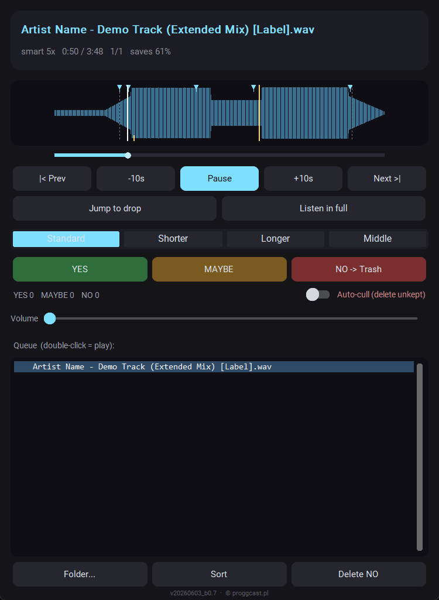
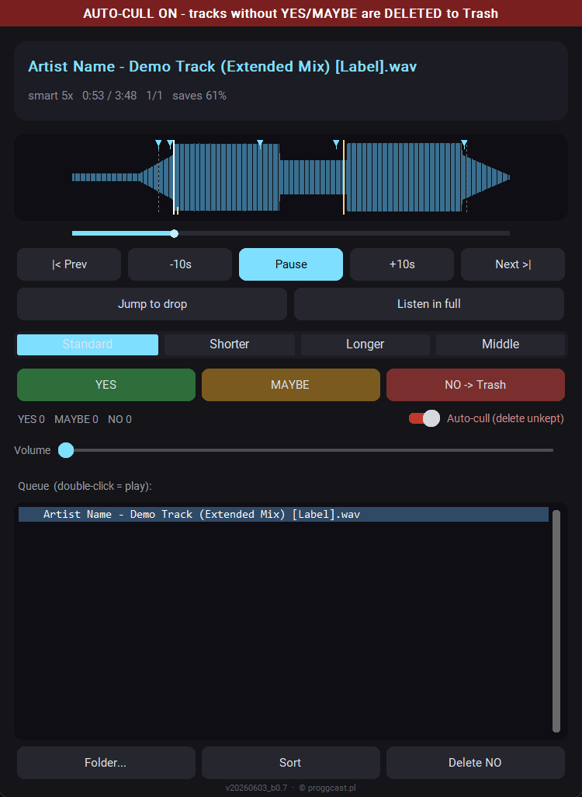
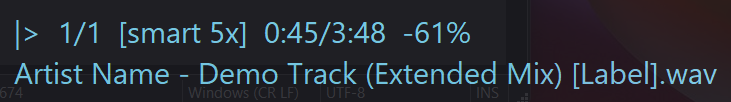

# Promo Music Mass Previewer - instrukcja

Aplikacja do szybkiego przesluchiwania (i odsiewania) duzej ilosci muzyki promo.
Zamiast sluchac kazdego utworu od poczatku do konca, player sam pomija intro/outro
i gra krotkie probki przez najwazniejsze fragmenty (z naciskiem na drop), a Ty
decydujesz: zachowac czy odrzucic. Dziala w tle - mozesz robic swoje, a reagowac
globalnymi skrotami albo z panelu.

---

## 1. Instalacja i pierwsze uruchomienie

Windows 10/11, 64-bit.

1. Pobierz `Promo_Music_Mass_Previewer.exe` z
   [Releases](https://github.com/kicikk/promo-music-mass-previewer-releases/releases/latest).
2. Wloz go do osobnego folderu, np. `Dokumenty\Promo Music Mass Previewer`. Program
   trzyma ustawienia (`config.json`) i plik logu obok `.exe`, wiec folder musi byc
   zapisywalny (nie `Program Files`).
3. Uruchom `.exe` dwuklikiem.

Przy starcie wskazujesz folder z muzyka. Aplikacja skanuje go (rekurencyjnie) i
zaczyna grac. Obslugiwane formaty: mp3, wav, flac, ogg, aiff, m4a.

### Aktywacja

Program dziala za darmo przez 3 dni. Przy kazdym starcie pokazuje okno aktywacji z
kodem Twojego komputera (`XXXX-XXXX-XXXX-XXXX`):

1. Kliknij **Wyslij e-mail** - otworzy sie program pocztowy z gotowa wiadomoscia na
   maciej@proggcast.pl z kodem w srodku. Albo kliknij **Kopiuj kod** i wyslij go
   dowolnie.
2. Dostajesz z powrotem darmowy klucz aktywacyjny (zaczyna sie od `PMMP1-`).
3. Wklej go w pole i kliknij **Aktywuj**. Okno juz sie nie pokaze.

W trakcie proby **Kontynuuj probe** uruchamia program bez klucza. Po 3 dniach zostaje
tylko aktywacja.

- Klucz dziala tylko na komputerze, dla ktorego zostal wydany.
- Aktywacja odbywa sie offline - program nie laczy sie z zadnym serwerem.
- Przeniesienie `.exe` albo aktualizacja do nowej wersji zachowuja aktywacje.
- Po reinstalacji Windowsa kod komputera sie zmienia - wystarczy wyslac nowy.

Okno aktywacji jest w jezyku ustawionym w `config.json` (`"language": "pl"`;
domyslnie angielski).

### Windows ostrzega przed .exe albo go blokuje

`.exe` nie jest podpisany cyfrowo - certyfikat do podpisywania kodu kosztuje kilkaset
dolarow rocznie i ta aplikacja go nie ma. To nie znaczy, ze plik jest zarazony.

- **SmartScreen** ("System Windows ochronil ten komputer"): kliknij **Wiecej
  informacji** -> **Uruchom mimo to**. Tylko za pierwszym razem.
- **Inteligentna kontrola aplikacji** (Smart App Control, Windows 11: komunikat, ze nie
  udalo sie zweryfikowac wydawcy, bez opcji uruchomienia): ta funkcja blokuje kazdy
  program bez podpisu od zaufanego wystawcy i w odroznieniu od SmartScreena nie ma
  opcji "uruchom mimo to" dla pojedynczego pliku. Jedyne wyjscie to ja wylaczyc:
  Zabezpieczenia Windows -> Kontrola aplikacji i przegladarki -> Inteligentna kontrola
  aplikacji -> Wylaczone. Wylacza to ochrone calego systemu.

---

## 2. Panel - glowne okno

Od gory:

- **Nazwa utworu** (na niebiesko).
- **Linijka stanu**: tryb (np. `smart 5x`), pozycja `0:50 / 3:48`, numer w kolejce
  `1/1`, oraz `saves 61%` - czyli ile czasu oszczedzasz w tym trybie w stosunku do
  pelnego odsluchu.
- **Waveform** (wykres glosnosci calego utworu) - patrz punkt 4.
- **Pasek postepu** pod waveformem - klikalny (przewijanie myszka).
- **Transport**: `|< Prev` (poprzedni), `-10s`, `Pause/Play`, `+10s`, `Next >|`
  (nastepny).
- `Jump to drop` - skok do najblizszego dropu wzgledem aktualnej pozycji.
- `Listen in full` - wylacza skip dla tego jednego utworu (sluchasz w calosci).
- **Tryb skanowania**: `Standard / Shorter / Longer / Middle` - patrz punkt 3.
- **Oceny**: `YES` (zachowaj), `MAYBE`, `NO -> Trash` (do Kosza) + liczniki.
- **Auto-cull** (przelacznik po prawej) - patrz punkt 6.
- **Volume** - glosnosc.
- **Queue** - lista utworow. Podwojny klik = przeskok do danego utworu. Pole filtra
  nad lista zawezaja ja do wpisow, ktorych nazwa zawiera wpisany tekst (na zywo, bez
  rozroznienia wielkosci liter). "x" wewnatrz pola (lub Esc) czysci filtr. Filtr zmienia
  tylko widok - kolejnosc grania i oceny bez zmian.
- Dol: `Folder...` (zmiana folderu), `Purge deleted` (oproznienie folderu to_delete).
  (Zbiorcze `Sort` i `Delete NO` sa teraz w menu zasobnika - patrz punkt 5.)

Zamkniecie okna (X) zamyka cala aplikacje. Zeby tylko schowac panel (a grac dalej
w tle), uzyj menu w zasobniku albo lewego klikniecia na ikonie obok zegara.

---

## 3. Tryby skanowania

Wybierasz, jak gesto i jak dlugo player probkuje utwor:

- **Standard** - probka 18 s, przeskok 35 s (domyslny).
- **Shorter** - krotsze, czestsze probki (wiecej skokow).
- **Longer** - dluzsze, rzadsze probki.
- **Middle** - bez probkowania, gra ciagle sam srodek utworu (od konca intro do
  poczatku outro).

Wskaznik `saves X%` pokazuje, ile czasu zaoszczedzisz danym trybem.

Najedz myszka na dany tryb, zeby zobaczyc krotki dymek z opisem (dlugosc probki /
przeskok, albo "ciagly srodek").

---

## 4. Waveform - co oznaczaja markery

Na wykresie glosnosci:

- **Cyjanowe trojkaty u gory** - miejsca, do ktorych player przeskoczy (poczatki
  probek). To jest plan odsluchu.
- **Zolte linie** - wykryte dropy/narosty energii. Glowny drop to wejscie po
  najdluzszym breakdownie. Sa chronione - player ich nie utnie.
- **Szare przerywane** - koniec intra i poczatek outro.
- **Bialy pionowy kursor** - aktualna pozycja odtwarzania.

Markery skipow celuja kilka sekund PRZED kazdym dropem, zebys slyszal jego wejscie,
a nie wpadal w srodek.

Klik w waveform = przewiniecie tam. Po recznym przewinieciu player gra dalej od
tego miejsca i normalnie skipuje do przodu (nie cofa sie).

---

## 5. Ocenianie i segregacja

- **YES** - zachowujesz. Jesli wlaczone `move_on_yes`, plik od razu trafia do
  podfolderu `selected`.
- **MAYBE** - oznaczenie posrednie (tez liczone jako zachowane).
- **NO** - odrzucasz. Jesli wlaczone `delete_on_no`, plik jest od razu usuwany
  (patrz "Jak dziala kasowanie" nizej).

Oceny zapisuja sie na biezaco do pliku `promo_player_marks.csv` w folderze z muzyka.

Uwaga: przy domyslnych ustawieniach YES od razu idzie do `selected`, a NO / auto-cull
do `to_delete` - wiec wiekszosc segregacji dzieje sie w trakcie oceniania. Ponizsze
akcje zbiorcze sa tylko dla resztek (np. MAYBE) albo gdy wylaczysz natychmiastowe
akcje. Sa w menu zasobnika (prawy klik na ikonie):
- `Sort` / Segregacja - przenosi wciaz lezace ocenione pliki do `_YES`, `_MAYBE`, `_NO`.
- `Delete NO` - usuwa oznaczone NO, ktore nie zostaly jeszcze usuniete.

Na dole panelu:
- `Purge deleted` - oprozdnia folder `to_delete` (patrz nizej).
- Eksport playlist M3U (z menu zasobnika).

### Jak dziala kasowanie (dwa tryby)

Ustawiane przez `delete_mode` w konfiguracji:

- `folder` (domyslny, najbezpieczniejszy) - nic nie ginie od razu. NO, `Delete NO`
  i auto-cull PRZENOSZA plik do podfolderu `to_delete` (tworzony jesli brak). Pliki
  po prostu tam czekaja. Zeby je naprawde skasowac, klikasz `Purge deleted`
  (przycisk pokazuje licznik, np. `Purge deleted (12)`) albo kasujesz folder recznie
  w Eksploratorze/Finderze. `Purge deleted` prosi o potwierdzenie i wysyla zawartosc
  do Kosza (odwracalne).
- `recycle` - stare zachowanie: NO / Delete NO / auto-cull leca od razu do Kosza
  (albo trwale, jesli `delete_to_recycle_bin` jest false).

Sens trybu `folder`: jesli podczas auto-cull odejdziesz od komputera i zapomnisz
zapauzowac, nic nie przepada - utwory tylko zbieraja sie w `to_delete` i mozesz je
przywrocic, przenoszac z powrotem.

W kazdym przypadku wpis na playliscie zostaje (czerwony = skasowany), nie znika.

---

## 6. Auto-cull - tryb agresywnego odsiewania (UWAGA)

Do masowego czyszczenia. Po wlaczeniu: utwor, ktorego NIE zachowasz (YES albo
MAYBE), jest usuwany przy przejsciu dalej (Next albo gdy player sam przejdzie do
nastepnego). Zalozenie: brak akcji = nie podoba sie. Zeby cos zostawic, musisz
swiadomie kliknac YES.

Przy domyslnym `delete_mode: folder` "usuwany" znaczy przeniesiony do folderu
`to_delete` - wiec nawet jesli zostawisz wlaczony auto-cull bez nadzoru, nic nie
przepada, dopoki nie klikniesz `Purge deleted`. Baner pokazuje rzeczywisty cel.

Tryb jest WYRAZNIE oznaczony:
- czerwony baner na gorze panelu,
- nakladka w rogu robi sie czerwona z dopiskiem `[AUTO-CULL]`.

Wlaczenie (przelacznik w panelu) wymaga potwierdzenia. Domyslnie wylaczone.

Wazne: auto-cull kasuje tylko od aktualnej pozycji w przod. Wszystko, co bylo w
playliscie PRZED momentem wlaczenia, jest chronione i nie zostanie skasowane -
nawet jesli sie do tego cofniesz.

Bezpiecznik: kasowanie idzie do Kosza, wiec pomylki odzyskasz.

---

## 7. Nakladka "now playing"

Maly napis w rogu ekranu, zawsze na wierzchu, klikalny na wylot (klikniecia
przechodza pod spod) i nie przejmuje fokusa - nie przeszkadza w pracy. Pokazuje:
stan (gra/pauza), numer w kolejce, tryb, pozycje/dlugosc, oszczednosc czasu i
ewentualna ocene. Pozycje i wyglad ustawisz w konfiguracji.

---

## 8. Globalne skroty (dzialaja, gdy okno jest schowane)

| Skrot | Akcja |
|---|---|
| Ctrl+Alt+Right | nastepny utwor |
| Ctrl+Alt+Left | poprzedni utwor |
| Ctrl+Alt+Space | pauza / wznow |
| Ctrl+Alt+Up | oznacz YES (zachowaj) |
| Ctrl+Alt+Down | oznacz NO |
| Ctrl+Alt+M | oznacz MAYBE |
| Ctrl+Alt+L | posluchaj w calosci |
| Ctrl+Alt+D | skok do najblizszego dropu |
| Ctrl+Alt+R | od poczatku tego utworu |
| Ctrl+Alt+S | skip wl./wyl. |
| Ctrl+Alt+Shift+Right / Left | przewin o 10 s w przod / w tyl |
| Ctrl+Alt+plus / minus (numpad) | glosniej / ciszej |

Skroty zmienisz w `config.json` w sekcji `hotkeys`. Mozna przypisac kilka kombinacji
do jednej akcji (np. strzalka dla klawiatury + litera dla Stream Decka).

Uwaga: jesli skroty nie reaguja, sprobuj uruchomic aplikacje jako administrator.

---

## 9. Stream Deck

Emulacja klawiszy ze Stream Decka bywa zawodna, dlatego aplikacja ma wlasny kanal
polecen: maly serwer HTTP nasluchujacy tylko na Twoim komputerze (`127.0.0.1`, port
48757). Przycisk po prostu wywoluje adres, bez emulacji klawiszy.

W Stream Decku zainstaluj darmowy plugin do zapytan HTTP (np. BarRaider "API Ninja"
albo "Web Requests") i ustaw przycisk na:

GET `http://127.0.0.1:48757/<akcja>`

Akcje: `next`, `prev`, `play_pause`, `mark_yes`, `mark_no`, `mark_maybe`,
`listen_full`, `jump_drop`, `replay`, `toggle_skip`, `vol_up`, `vol_down`, `seek_fwd`,
`seek_back`, `panel_toggle`, `auto_cull` (kazde wcisniecie przelacza tryb),
`purge_deleted`.

Pokazanie stanu przelacznika na przycisku (opcjonalnie): ustaw tytul pluginu na
tylko-odczytowy endpoint stanu:

- przelaczenie na wcisniecie: GET `http://127.0.0.1:48757/auto_cull`
- tytul (odpytywany co 1-2 s): GET `http://127.0.0.1:48757/state/auto_cull`
  - zwraca czysty tekst `ON` albo `OFF`

`http://127.0.0.1:48757/state` (bez klucza) zwraca JSON ze wszystkimi stanami
(`auto_cull`, `skip`, `paused`). Uzyj portu z `config.json` (`command_port`,
domyslnie 48757).

---

## 10. Ustawienia (config.json)

Plik `config.json` lezy obok `.exe` (menu zasobnika -> Otworz config.json). Najwazniejsze:

| Klucz | Znaczenie |
|---|---|
| language | "en" (domyslnie) lub "pl" - jezyk interfejsu |
| snippet_sec / gap_sec | dlugosc probki / przeskok (tryb Standard) |
| drop_lead_sec | ile sekund przed dropem ustawia sie marker (domyslnie 4) |
| move_on_yes / yes_dir | YES przenosi plik do podfolderu (domyslnie "selected") |
| delete_on_no | NO usuwa biezacy plik od razu (wg delete_mode) |
| delete_mode | "folder" (przenies do to_delete, domyslnie) lub "recycle" (od razu) |
| to_delete_dir | nazwa folderu miekkiego kasowania (domyslnie "to_delete") |
| delete_to_recycle_bin | true = Kosz (odwracalne), false = trwale |
| auto_cull | tryb agresywnego odsiewania (domyslnie false) |
| skip_marked | pomijaj utwory juz ocenione w poprzednich sesjach |
| overlay_corner / overlay_margin | pozycja nakladki |
| notifications | powiadomienia Windows przy ocenie (domyslnie false) |

Po zmianie konfiguracji zrestartuj aplikacje.

---

Wersja widoczna jest na dole panelu (np. v20260603_b0.7).

Developed by Maciej Kiciński (kicikk), powered by proggcast.pl
(c) proggcast.pl

## 11. Tryb Spotify (wymaga Premium)

Przesluchiwanie katalogu Spotify dokladnie tak samo jak plikow: appka skacze po
utworze, oceniasz tymi samymi skrotami, leci dalej. Dzwiek gra w Twoim kliencie
Spotify - previewer steruje nim przez Spotify Connect.

**Co dostajesz:** cala dyskografia artysty albo dowolny album czy playlista, bez
zakladania czegokolwiek. Kolejke trzyma appka.

**Czego nie dostajesz:** detekcji dropu i waveformu. Spotify nie udostepnia probek
audio (DRM), wiec nie ma czego analizowac. Skip na sekundach i wszystkie tryby
skanowania dzialaja normalnie.

### Konfiguracja (raz)

1. Wejdz na **developer.spotify.com** -> Dashboard -> **Create app**.
2. Wpisz dowolna nazwe i opis. W polu **Redirect URIs** wklej dokladnie:
   `http://127.0.0.1:48758/callback` i kliknij **Add**. Uwaga: `localhost` nie
   zadziala - Spotify przyjmuje tylko jawny adres petli zwrotnej.
3. Zaznacz **Web API**, zaakceptuj regulamin, **Save**.
4. Skopiuj **Client ID** ze strony aplikacji.
5. W previewerze nacisnij **Spotify...** (przycisk w panelu albo pozycja w menu
   zasobnika), wklej Client ID, nacisnij **Polacz** i zatwierdz w przegladarce.

Kazdy, kto uzywa appki, zaklada sobie wlasna aplikacje Spotify - w programie nie ma
zaszytych zadnych cudzych dostepow. Twoj token siedzi w `spotify_auth.json` obok
configu.

### Codzienne uzycie

- Uruchom klienta Spotify i zagraj cokolwiek raz, zeby previewer zobaczyl urzadzenie.
  Wybierz je pod **Urzadzenie odtwarzajace**.
- W polu **Co przesluchac** wpisz nazwe artysty albo wklej link/URI do artysty, albumu
  lub playlisty. Wybierz sortowanie (data wydania, tytul, dlugosc...) i nacisnij
  **Wczytaj**.
- Albo kliknij dwukrotnie jedna ze swoich playlist na liscie ponizej.
- Oceniaj normalnymi skrotami. Oceny ida do `spotify_marks.csv` obok configu. Przy
  kolejnym wejsciu na to samo zrodlo juz ocenione sa pomijane.

### Duze dyskografie, cache i dzienny limit Spotify

Twoja aplikacja deweloperska ma **dzienny limit zapytan do API**. Po jego
przekroczeniu Spotify odmawia wszystkiego na kilkanascie-dwadziescia godzin
(niezaleznie od zrodla), a appka powie wprost, za ile wrocic.

Dlatego dyskografia jest pobierana **raz**. Pierwsze wejscie na artystu kosztuje
mniej wiecej jedno zapytanie na wydawnictwo - u plodnego producenta (np. Gai
Barone: 240 wydawnictw) to okolo 260 zapytan i kilka minut. Wynik zapisuje sie
w cache i **kazde nastepne wczytanie, takze po restarcie aplikacji, jest
natychmiastowe i nie kosztuje ani jednego zapytania**.

- **Wczytaj** - bierze z cache, jesli dyskografia byla juz pobrana.
- **Sprawdz nowe** - odczytuje liste wydawnictw na nowo i dociaga tylko te,
  ktorych jeszcze nie masz. Dla artysty bez nowosci to okolo 25 zapytan zamiast
  260, bo zawartosc znanych wydawnictw brana jest z cache.

Status po wczytaniu pokazuje, ile zapytan poszlo - warto na to patrzec, bo to
Twoj dzienny budzet.

Jesli wolisz oszczedniej kosztem kompletnosci, w `config.json` w sekcji `spotify`
ustaw `"discography_mode": "search"`. Wtedy dyskografia leci przez wyszukiwarke:
okolo 15 zapytan zamiast 260, ale bez gwarancji kompletnosci i z limitem 1000
utworow na artyste.

### Ograniczenia

- **Cudzych playlist nie da sie odczytac** - Spotify odmawia nawet przy publicznych.
  Dostepne sa tylko wlasne. Obejscie: otworz playliste w kliencie Spotify, zaznacz
  utwory, "Dodaj do playlisty" i wskaz previewerowi swoja kopie.
- Operacje na plikach (segregacja do podfolderow, kasowanie, auto-cull, eksport M3U) sa
  w trybie Spotify wylaczone - nie ma pliku do ruszenia. Oceny i tak zapisuja sie w CSV.
- Pierwsze wczytanie duzej dyskografii trwa ~20 sekund, potem jest brane z cache (patrz wyzej).
