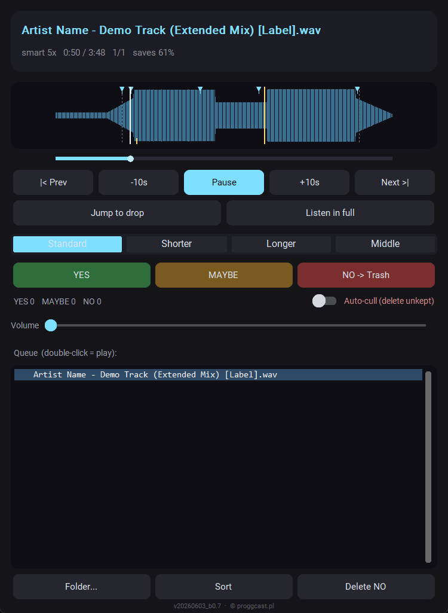
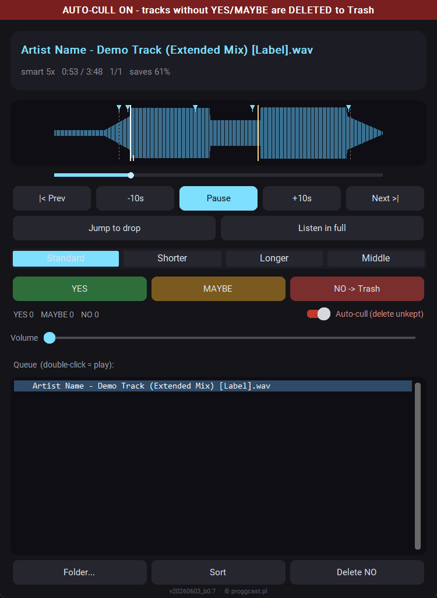
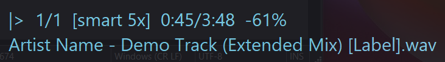

# Promo Music Mass Previewer - manual

A tool for quickly previewing (and culling) large amounts of promo music. Instead
of listening to every track start to finish, the player automatically skips the
intro/outro and plays short samples across the most important parts (focused on the
drop), while you decide: keep or reject. It runs in the background - you can do your
own thing and react with global hotkeys or from the panel.

---

## 1. Installation and first launch

Windows 10/11, 64-bit.

1. Download `Promo_Music_Mass_Previewer.exe` from
   [Releases](https://github.com/kicikk/promo-music-mass-previewer-releases/releases/latest).
2. Put it in a folder of its own, e.g. `Documents\Promo Music Mass Previewer`. The app
   keeps its settings (`config.json`) and a log file next to the exe, so the folder
   must be writable (not `Program Files`).
3. Double-click the exe.

On start you pick a folder with music. The app scans it (recursively) and begins
playing. Supported formats: mp3, wav, flac, ogg, aiff, m4a.

### Activation

The program runs free for 3 days. Every start shows the activation window with your
machine code (`XXXX-XXXX-XXXX-XXXX`):

1. Press **Send e-mail** - your mail program opens a ready message to
   maciej@proggcast.pl with the code in it. Or press **Copy code** and send it any way
   you like.
2. You get back a free activation key (it starts with `PMMP1-`).
3. Paste it into the field and press **Activate**. The window will not appear again.

During the trial, **Continue trial** starts the program without a key. After 3 days
only activation is possible.

- A key works only on the computer it was issued for.
- Activation is offline - the program does not contact any server.
- Moving the exe or updating to a newer version keeps the activation.
- Reinstalling Windows changes the machine code - just send the new one.

The activation window follows the `language` setting in `config.json` (English by
default).

### Windows warns about or blocks the .exe

The exe is not digitally signed - a code signing certificate costs several hundred
dollars a year and this app does not have one. It does not mean the file is infected.

- **SmartScreen** ("Windows protected your PC"): click **More info** -> **Run anyway**.
  Needed only the first time.
- **Smart App Control** (on Windows 11: "the publisher could not be verified", with no
  option to run): this feature blocks every program that is not signed by a trusted
  authority and, unlike SmartScreen, has no "run anyway" option for a single file. The
  only way is to switch it off: Windows Security -> App & browser control -> Smart App
  Control settings -> Off. That disables the protection system-wide.

---

## 2. The panel - main window

From the top:

- **Track name** (in blue).
- **Status line**: mode (e.g. `smart 5x`), position `0:50 / 3:48`, queue number
  `1/1`, and `saves 61%` - how much time you save in this mode versus a full listen.
- **Waveform** (loudness graph of the whole track) - see section 4.
- **Progress bar** under the waveform - clickable (seek with the mouse).
- **Transport**: `|< Prev`, `-10s`, `Pause/Play`, `+10s`, `Next >|`.
- `Jump to drop` - jumps to the nearest drop relative to the current position.
- `Listen in full` - turns off skipping for this one track (plays it whole).
- **Scan mode**: `Standard / Shorter / Longer / Middle` - see section 3.
- **Marks**: `YES` (keep), `MAYBE`, `NO -> Trash` + counters.
- **Auto-cull** (switch on the right) - see section 6.
- **Volume**.
- **Queue** - track list. Double-click = jump to that track. The filter box above the
  list narrows it to entries whose filename contains the typed text (live,
  case-insensitive). The "x" inside the box (or Esc) clears the filter. Filtering only
  changes what is shown - playback order and marks are unchanged.
- Bottom: `Folder...` (change folder), `Purge deleted` (empty the to_delete folder).
  (Batch `Sort` and `Delete NO` live in the tray menu now - see section 5.)

Closing the window (X) quits the whole app. To only hide the panel (and keep
playing in the background), use the tray menu or left-click the tray icon near the
clock.

---

## 3. Scan modes

You choose how dense and how long the player samples the track:

- **Standard** - 18 s sample, 35 s skip (default).
- **Shorter** - shorter, more frequent samples (more jumps).
- **Longer** - longer, less frequent samples.
- **Middle** - no sampling, plays the middle of the track continuously (from the
  end of the intro to the start of the outro).

The `saves X%` indicator shows how much time the current mode saves.

Hover the mouse over a mode to see a short tooltip describing it (sample length /
skip, or "continuous middle").

---

## 4. Waveform - what the markers mean

On the loudness graph:

- **Cyan triangles at the top** - the points the player will jump to (sample
  starts). This is the preview plan.
- **Amber lines** - detected drops / energy rises. The main drop is the entry right
  after the longest breakdown. They are protected - the player will not cut them off.
- **Gray dashed lines** - end of the intro and start of the outro.
- **White vertical cursor** - the current playback position.

Skip markers aim a few seconds BEFORE each drop, so you hear its entry instead of
landing in the middle of it.

Click the waveform = seek there. After a manual seek the player keeps playing from
that spot and skips forward normally (it does not jump backward).

---

## 5. Marking and sorting

- **YES** - keep it. If `move_on_yes` is enabled, the file is moved to the
  `selected` subfolder immediately.
- **MAYBE** - an in-between mark (also counts as kept).
- **NO** - rejects it. If `delete_on_no` is on, the file is removed right away
  (see "How deleting works" below).

Marks are saved on the fly to `promo_player_marks.csv` in the music folder.

Note: with the defaults, YES already moves to `selected`, NO / auto-cull already move
to `to_delete` - so most sorting happens as you rate. The batch actions below are only
for leftovers (e.g. MAYBE) or if you turned the immediate actions off. They live in the
tray menu (right-click the tray icon):
- `Sort` - moves any still-in-place rated files into subfolders `_YES`, `_MAYBE`, `_NO`.
- `Delete NO` - removes any tracks marked NO that were not already removed.

On the panel bottom row:
- `Purge deleted` - empties the `to_delete` folder (see below).
- Export M3U playlists (from the tray menu).

### How deleting works (two modes)

Set with `delete_mode` in the config:

- `folder` (default, safest) - nothing is destroyed right away. NO, `Delete NO`
  and auto-cull all MOVE the file into a `to_delete` subfolder (created if missing).
  Files just sit there until you decide. To actually delete them, press
  `Purge deleted` (button shows the count, e.g. `Purge deleted (12)`) or delete the
  folder yourself in Explorer/Finder. `Purge deleted` asks for confirmation and
  sends the contents to the Recycle Bin (recoverable).
- `recycle` - the old behavior: NO / Delete NO / auto-cull go straight to the
  Recycle Bin (or permanently if `delete_to_recycle_bin` is false).

The point of `folder` mode: if you walk away during auto-cull and forget to pause,
nothing is lost - the tracks only pile up in `to_delete` and you can recover them by
moving them back.

In all cases the playlist entry stays (red = deleted), it does not disappear.

---

## 6. Auto-cull - aggressive culling mode (CAUTION)

For mass cleanup. Once enabled: any track you do NOT keep (YES or MAYBE) is removed
when you move on (Next, or when the player advances by itself). The assumption: no
action = you do not like it. To keep something, you must deliberately press YES.

With the default `delete_mode: folder`, "removed" means moved to the `to_delete`
folder - so even if you leave auto-cull running unattended, nothing is actually
destroyed until you press `Purge deleted`. The banner shows the real destination.

The mode is clearly marked:
- a red banner at the top of the panel,
- the corner overlay turns red with an `[AUTO-CULL]` tag.

Turning it on (the panel switch) requires confirmation. Off by default.

Important: auto-cull only deletes from the current position forward. Everything that
was in the playlist BEFORE you turned it on is protected and will not be deleted -
even if you go back to it.

Safety net: deletion goes to the Recycle Bin, so mistakes are recoverable.

---

## 7. The "now playing" overlay

A small caption in the corner of the screen, always on top, click-through (clicks
pass through to whatever is underneath) and it does not steal focus - so it does not
get in your way. It shows: state (playing/paused), queue number, mode,
position/length, time saved, and the current mark if any. Position and look are set
in the config.

---

## 8. Global hotkeys (work even when the window is hidden)

| Hotkey | Action |
|---|---|
| Ctrl+Alt+Right | next track |
| Ctrl+Alt+Left | previous track |
| Ctrl+Alt+Space | pause / resume |
| Ctrl+Alt+Up | mark YES (keep) |
| Ctrl+Alt+Down | mark NO |
| Ctrl+Alt+M | mark MAYBE |
| Ctrl+Alt+L | listen in full |
| Ctrl+Alt+D | jump to nearest drop |
| Ctrl+Alt+R | restart this track |
| Ctrl+Alt+S | skip on / off |
| Ctrl+Alt+Shift+Right / Left | seek 10 s forward / back |
| Ctrl+Alt+plus / minus (numpad) | volume up / down |

You can change the hotkeys in `config.json`, section `hotkeys`. You can assign
several combinations to one action (e.g. an arrow for the keyboard plus a letter for
the Stream Deck).

Note: if the hotkeys do not respond, try running the app as administrator.

---

## 9. Stream Deck

Stream Deck key emulation can be unreliable, so the app has its own command channel:
a small HTTP server listening only on your computer (`127.0.0.1`, port 48757). A button
just calls an address, with no key emulation.

In Stream Deck install a free HTTP request plugin (for example BarRaider "API Ninja"
or "Web Requests") and set the button to:

GET `http://127.0.0.1:48757/<action>`

Actions: `next`, `prev`, `play_pause`, `mark_yes`, `mark_no`, `mark_maybe`,
`listen_full`, `jump_drop`, `replay`, `toggle_skip`, `vol_up`, `vol_down`, `seek_fwd`,
`seek_back`, `panel_toggle`, `auto_cull` (each press toggles the mode on/off),
`purge_deleted`.

Showing the toggle state on the button (optional): point the plugin's title at the
read-only state endpoint:

- toggle on press: GET `http://127.0.0.1:48757/auto_cull`
- title (polled every 1-2 s): GET `http://127.0.0.1:48757/state/auto_cull`
  - returns the plain text `ON` or `OFF`

`http://127.0.0.1:48757/state` (no key) returns JSON with all states
(`auto_cull`, `skip`, `paused`). Use the port from your `config.json`
(`command_port`, default 48757).

---

## 10. Settings (config.json)

The `config.json` file lives next to the exe (tray menu -> Open config.json). The most important keys:

| Key | Meaning |
|---|---|
| language | "en" (default) or "pl" - interface language |
| snippet_sec / gap_sec | sample length / skip (Standard mode) |
| drop_lead_sec | seconds before the drop the marker is placed (default 4) |
| move_on_yes / yes_dir | YES moves the file to a subfolder (default "selected") |
| delete_on_no | NO removes the current file immediately (per delete_mode) |
| delete_mode | "folder" (move to to_delete, default) or "recycle" (straight delete) |
| to_delete_dir | name of the soft-delete folder (default "to_delete") |
| delete_to_recycle_bin | true = Recycle Bin (recoverable), false = permanent |
| auto_cull | aggressive culling mode (default false) |
| skip_marked | skip tracks already rated in previous sessions |
| overlay_corner / overlay_margin | overlay position |
| notifications | Windows toasts on marking (default false) |

Restart the app after changing the config.

---

The version is shown at the bottom of the panel (e.g. v20260603_b0.7).

Developed by Maciej Kiciński (kicikk), powered by proggcast.pl
(c) proggcast.pl

## 11. Spotify mode (Premium required)

Preview the Spotify catalogue the same way you preview files: the app skips through
each track, you rate with the same hotkeys, and it moves on. Playback happens in your
own Spotify app - the previewer drives it over Spotify Connect.

**What you get:** an artist's entire discography, or any album or playlist, without
having to build a playlist first. The queue lives in the app.

**What you don't get:** drop detection and the waveform. Spotify does not expose the
audio samples (DRM), so there is nothing to analyse. Fixed-second skipping and all the
scan modes work normally.

### One-time setup

1. Go to **developer.spotify.com** -> Dashboard -> **Create app**.
2. Fill in any name and description. Under **Redirect URIs** paste exactly:
   `http://127.0.0.1:48758/callback` and click **Add**. Note: `localhost` will not
   work - Spotify only accepts the literal loopback address.
3. Tick **Web API**, accept the terms, **Save**.
4. Copy the **Client ID** from the app page.
5. In the previewer press **Spotify...** (panel button or tray menu), paste the Client
   ID, press **Connect** and approve in the browser.

Everyone who uses the app creates their own Spotify app this way - no credentials are
built into the program. Your token is stored in `spotify_auth.json` next to the config.

### Daily use

- Open the Spotify desktop app and play anything once, so the previewer can see the
  device. Pick it under **Playback device**.
- In **What to preview** type an artist name, or paste a link/URI to an artist, album
  or playlist. Pick a sort order (release date, title, duration...) and press **Load**.
- Or double-click one of your playlists in the list below.
- Rate with the usual hotkeys. Ratings go to `spotify_marks.csv` next to the config.
  Next time you load the same source, everything you already rated is skipped.

### Large discographies, the cache and Spotify's daily quota

Your development-mode app has a **daily API request quota**. Once it runs out,
Spotify refuses everything for the next fifteen to twenty hours regardless of the
source, and the app tells you exactly when to come back.

That is why a discography is fetched **once**. The first visit to an artist costs
roughly one request per release - for a prolific producer (e.g. Gai Barone: 240
releases) that is about 260 requests and a few minutes. The result is cached, and
**every later load, including after restarting the app, is instant and costs no
requests at all**.

- **Load** - uses the cache if the discography was already fetched.
- **Check new** - re-reads the release list and downloads only what you do not
  have yet. For an artist with no new releases that is about 25 requests instead
  of 260, because known releases come from the cache.

The status line after loading shows how many requests were spent - worth watching,
since that is your daily budget.

If you prefer to spend less at the cost of completeness, set
`"discography_mode": "search"` in the `spotify` section of `config.json`. The
discography then comes from the search endpoint: about 15 requests instead of 260,
but with no completeness guarantee and a cap of 1000 tracks per artist.

### Limitations

- **Playlists owned by other people cannot be read** - Spotify returns an error even
  for public ones. Only your own are available. Workaround: open the playlist in the
  Spotify app, select the tracks, "Add to playlist" and point the previewer at your
  copy.
- File operations (sorting into subfolders, deleting, auto-cull, M3U export) are off in
  Spotify mode - there is no file to move. Your ratings are still recorded in the CSV.
- The first load of a large discography takes ~20 seconds; after that it comes from the cache (see above).
