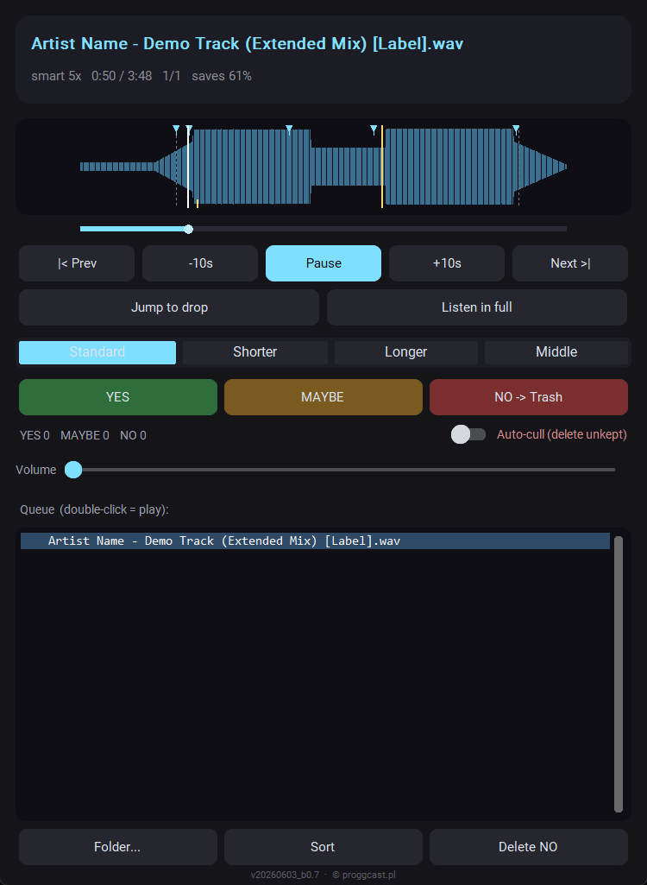

# Promo Music Mass Previewer

Preview hundreds of promo tracks in the time it takes to listen to a few dozen.

by [proggcast.pl](https://www.proggcast.pl) ·
[Proggcast on YouTube](https://www.youtube.com/@proggcastpl)

The player runs in the background, skips intros and outros, and plays short samples
through each track, landing a few seconds before every drop. You keep working and rate
with global hotkeys: **YES** moves the file to `selected`, **NO** moves it to
`to_delete`, and the next track starts. With Spotify Premium you can preview an
artist's whole discography, an album or a playlist the same way.

**[Download Promo_Music_Mass_Previewer_v20261108_b6.2.exe](https://github.com/kicikk/PromoMusicMassPreviewer/releases/download/v20261108_b6.2/Promo_Music_Mass_Previewer_v20261108_b6.2.exe)**

Current version: **v20261108_b6.2** (2026-11-08) · Windows 10/11, 64-bit, a single `.exe`,
no installation · [What's new](CHANGELOG.md) · [All releases](https://github.com/kicikk/PromoMusicMassPreviewer/releases)

**macOS (beta):** [Apple Silicon (.dmg)](https://github.com/kicikk/PromoMusicMassPreviewer/releases/download/v20261108_b6.2/Promo_Music_Mass_Previewer_v20261108_b6.2_mac_arm64.dmg) · [Intel (.dmg)](https://github.com/kicikk/PromoMusicMassPreviewer/releases/download/v20261108_b6.2/Promo_Music_Mass_Previewer_v20261108_b6.2_mac_x86_64.dmg) - see [macOS notes](MAC.md) before the first launch.

## Features

- **Smart skip** based on loudness analysis: finds the end of the intro, the drops and
  the outro, and never cuts a drop off.
- **Four scan modes** (Standard / Shorter / Longer / Middle) with a "time saved"
  indicator.
- **Waveform** with the preview plan marked on it; click to seek.
- **Global hotkeys** that work while the window is hidden, plus an always-on-top,
  click-through "now playing" overlay.
- **Sorting as you rate**: ratings go to a CSV file, files move to folders right away.
- **Auto-cull** for mass cleanup: anything you don't keep goes to `to_delete`, and
  nothing is destroyed until you purge it yourself.
- **Stream Deck** control through a local HTTP command channel.
- **Spotify mode** (Premium): an artist's discography, an album or a playlist, without
  building a playlist first.
- English and Polish interface.

Formats: mp3, wav, flac, ogg, aiff, m4a.

## Getting started

1. Download `Promo_Music_Mass_Previewer_v20261108_b6.2.exe` from
   [Releases](https://github.com/kicikk/PromoMusicMassPreviewer/releases/latest).
2. Put it in a folder of its own, e.g. `Documents\Promo Music Mass Previewer`. The app
   keeps its settings (`config.json`) next to the exe, so the folder must be writable
   (not `Program Files`).
3. Run it and pick a folder with music.

### Activation

The program runs free for **3 days**. Every start shows a window with your machine
code (`XXXX-XXXX-XXXX-XXXX`):

1. Press **Send e-mail** - your mail program opens a ready message to
   **maciej@proggcast.pl** with the code in it. (Or press **Copy code** and send it any
   way you like.)
2. You get back a free activation key (it starts with `PMMP1-`).
3. Paste it into the window and press **Activate**. The window will not appear again.

Good to know:

- A key works only on the computer it was issued for.
- Activation is offline. The program does not contact any server and sends nothing
  about you. (Spotify mode talks to Spotify only, with your own account.)
- Moving the exe or updating to a newer version keeps the activation.
- Reinstalling Windows changes the machine code - just send the new one.

### Updating

Download the new exe, put it in the same folder as the old one and delete the old one
(the version is part of the file name, so they don't overwrite each other). Settings,
ratings and the activation stay. If you made a shortcut, point it at the new file.
Your version is shown at the bottom of the panel; compare it with the current version
above.

### Windows warns about the exe

The exe is not digitally signed (a code-signing certificate costs several hundred
dollars a year), so Windows may react to it:

- **SmartScreen** - "Windows protected your PC": click **More info** -> **Run anyway**.
  Needed only the first time.
- **Smart App Control** - "the publisher could not be verified", with no option to run:
  this feature blocks every unsigned program and has no exception for a single file.
  The only way is to switch it off: Windows Security -> App & browser control ->
  Smart App Control settings -> Off. Note that this turns the protection off for the
  whole system.

## Documentation

- [Manual (English)](MANUAL.md)
- [Instrukcja (polski)](INSTRUKCJA.md)
- [Changelog](CHANGELOG.md)

## Versions

The version number is the build date plus a build number, e.g. `v20261106_b6.0`. The
same number appears in the file name (`Promo_Music_Mass_Previewer_v20261106_b6.0.exe`),
at the bottom of the panel, in the exe's properties (Details tab) and in the name of
the release here, so you can always tell which one you have.

---

## Po polsku

Szybkie przesłuchiwanie dużych ilości muzyki promo. Player gra w tle, sam pomija
intro i outro, gra krótkie próbki przez cały utwór (z wejściem kilka sekund przed
każdym dropem), a Ty oceniasz globalnymi skrótami: **YES** przenosi plik do
`selected`, **NO** do `to_delete`. Z kontem Spotify Premium tak samo przesłuchasz
całą dyskografię artysty, album albo playlistę.

**[Pobierz Promo_Music_Mass_Previewer_v20261108_b6.2.exe](https://github.com/kicikk/PromoMusicMassPreviewer/releases/download/v20261108_b6.2/Promo_Music_Mass_Previewer_v20261108_b6.2.exe)**

Aktualna wersja: **v20261108_b6.2** (2026-11-08) · Windows 10/11, 64-bit, jeden plik `.exe`,
bez instalacji · [Co nowego](CHANGELOG.md) · [Wszystkie wydania](https://github.com/kicikk/PromoMusicMassPreviewer/releases)

**macOS (beta, jeszcze nietestowana na prawdziwym Macu):** [Apple Silicon (.dmg)](https://github.com/kicikk/PromoMusicMassPreviewer/releases/download/v20261108_b6.2/Promo_Music_Mass_Previewer_v20261108_b6.2_mac_arm64.dmg) · [Intel (.dmg)](https://github.com/kicikk/PromoMusicMassPreviewer/releases/download/v20261108_b6.2/Promo_Music_Mass_Previewer_v20261108_b6.2_mac_x86_64.dmg) - przed pierwszym uruchomieniem zajrzyj do [MAC.md](MAC.md#po-polsku).

**Pierwsze uruchomienie:** włóż `.exe` do osobnego folderu (np.
`Dokumenty\Promo Music Mass Previewer` - program trzyma ustawienia obok siebie),
uruchom i wskaż folder z muzyką.

**Aktywacja:** program działa za darmo przez **3 dni**. Okno przy starcie pokazuje
kod Twojego komputera. Kliknij **Wyślij e-mail** (albo **Kopiuj kod**) i wyślij go
na **maciej@proggcast.pl** - odeślę darmowy klucz aktywacyjny dla tego komputera.
Wklejasz go i klikasz **Aktywuj**. Klucz działa tylko na tym komputerze. Aktywacja
odbywa się offline: program nie łączy się z żadnym serwerem i niczego o Tobie nie
wysyła. Przeniesienie `.exe` albo aktualizacja do nowej wersji zachowują aktywację.

**Aktualizacja:** pobierz nowy `.exe`, włóż go do tego samego folderu co stary, a
stary usuń (wersja jest w nazwie pliku, więc się nie nadpiszą) - ustawienia, oceny i
aktywacja zostają. Jeśli masz skrót, wskaż w nim nowy plik. Swoją wersję widzisz w
nazwie pliku, na dole panelu, we właściwościach pliku (zakładka Szczegóły) i w nazwie
wydania.

**Windows ostrzega przed plikiem:** `.exe` nie jest podpisany cyfrowo. Przy
SmartScreen kliknij **Więcej informacji** -> **Uruchom mimo to**. Inteligentna
kontrola aplikacji (Smart App Control) blokuje każdy niepodpisany program bez
wyjątków - jedyne wyjście to ją wyłączyć: Zabezpieczenia Windows -> Kontrola
aplikacji i przeglądarki -> Inteligentna kontrola aplikacji -> Wyłączone (wyłącza
to ochronę dla całego systemu).

Pełna instrukcja: [INSTRUKCJA.md](INSTRUKCJA.md).

---

The source code is not public. Questions and bug reports: maciej@proggcast.pl.

Developed by Maciej Kiciński (kicikk), powered by [proggcast.pl](https://www.proggcast.pl)
· [Proggcast on YouTube](https://www.youtube.com/@proggcastpl).
© proggcast.pl
